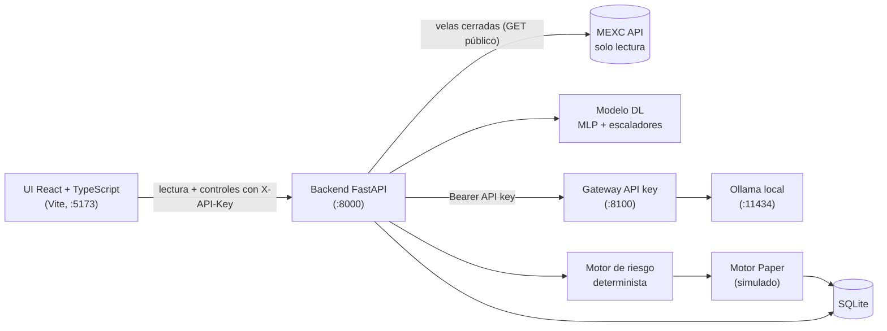

# Agente de trading ETH/USDT con IA local — v0.1.1

 -orange)  

Agente que **observa** velas diarias de ETH/USDT en MEXC, **consulta** un modelo de deep learning entrenado en la práctica de *Deep Learning para Finanzas*, **pide una propuesta** a un LLM que corre localmente con Ollama, la **valida** con controles de riesgo deterministas y la **ejecuta solo en simulación (Paper)**. Todo queda registrado en SQLite y se muestra en un panel web.

> ⚠️ Proyecto académico. **No envía órdenes reales**: no existe ninguna ruta de código que opere en MEXC. No es asesoría financiera.

**Autor:** Sebastián López · Universidad Iberoamericana León · Deep Learning para Finanzas (Prof. Rubén Miguel Rodríguez Rangel)

---

## Versión

| Versión | Fecha | Contenido |
|---|---|---|
| **0.1.1** | 2026-11-19 | El LLM solo puede proponer acciones válidas según la posición (esquema JSON con `enum` dinámico y `acciones_validas` en el contexto). Corrige que el modelo propusiera "comprar" con posición abierta y nunca vendiera (26 de 30 propuestas rechazadas en el primer replay con `llama3.2:3b`). 34 pruebas. |
| 0.1.0 | 2026-11-17 | Primera entrega: ciclo completo del agente (datos → modelo → LLM local → riesgo → Paper → registro → UI), gateway con API key, modo replay con comparación, 34 pruebas automatizadas. |

## Tecnologías aplicadas

| Capa | Tecnología | Uso |
|---|---|---|
| Interfaz | **React 18 + TypeScript + Vite 5** | Panel: activo, fecha de vela, pronóstico, indicadores, acción propuesta y motivo, estado de riesgo, posición, patrimonio; botones iniciar, pausar y detener |
| Backend | **Python 3.10+ · FastAPI · Uvicorn** | Coordina el ciclo, carga modelo y escalador, valida entradas y expone la API documentada (`/docs`) |
| Modelo predictivo | **PyTorch** | MLP del capítulo 8 (promedio de 3 semillas) que pronostica el rendimiento del día siguiente a partir de 20 rezagos |
| LLM local | **Ollama** (p. ej. `llama3.2:3b`) | Propone *comprar / mantener / vender* en JSON con esquema fijo; inferencia 100% local, sin nube |
| Seguridad del LLM | **Gateway FastAPI con API key** | Ollama no tiene autenticación por defecto: el gateway exige `Bearer <clave>` y solo permite `/api/chat`, `/api/tags` y `/api/version` |
| Datos de mercado | **API pública de MEXC** (`/api/v3/klines`, `exchangeInfo`, `ticker/price`) | Solo lectura, sin claves de trading |
| Persistencia | **SQLite** | Velas procesadas, decisiones, órdenes Paper, patrimonio, errores y estado (recuperación tras reinicio) |
| Pruebas | **pytest** | Controles de riesgo, motor Paper, validación del LLM, gateway, idempotencia y los 9 escenarios de error |

## Arquitectura



### Ciclo del agente (una decisión por vela diaria cerrada)

1. **Observar:** pide las velas a MEXC, descarta la vela en curso, valida orden, duplicados, días consecutivos, precios y antigüedad (máximo 26 h).
2. **Pronosticar:** calcula los 20 rezagos con la misma definición del entrenamiento (contrato en `backend/modelo/contrato.json`) y obtiene el rendimiento esperado del día siguiente.
3. **Proponer:** envía al LLM local **solo datos** (precio, pronóstico, umbral δ, indicadores, posición y patrimonio simulados). El LLM nunca recibe claves ni configuración.
4. **Validar JSON:** Ollama genera con un esquema que solo admite las acciones válidas en ese estado (sin posición: mantener/comprar; con posición: mantener/vender). Además se exige `accion ∈ {comprar, mantener, vender}`, `simbolo = ETHUSDT`, la fecha exacta de la vela y una justificación. Cualquier desviación se rechaza.
5. **Riesgo:** reglas deterministas que el LLM no puede saltarse ni modificar (exposición máxima, pérdida diaria, sin apalancamiento, sin ventas en corto, estado del agente).
6. **Ejecutar en Paper** en la apertura de la vela siguiente (t+1), con deslizamiento, precisión y monto mínimo del par. Guarda decisión, orden y patrimonio en una sola transacción. **Una vela nunca se procesa dos veces.**
7. **Mostrar** en la UI y esperar la siguiente vela.

## Estructura

```
agente-trading-eth/
├── backend/
│   ├── agente/            # config, mexc, modelo, llm, riesgo, paper, db, nucleo (ciclo)
│   ├── config/riesgo.json # límites de riesgo (el LLM no puede modificarlos)
│   ├── modelo/            # contrato.json + pesos versionados del modelo
│   ├── scripts/exportar_modelo.py
│   ├── tests/             # 34 pruebas automatizadas
│   ├── gateway.py         # gateway con API key para Ollama
│   ├── main.py            # API FastAPI
│   ├── requirements.txt
│   └── .env.example
└── frontend/              # React + TypeScript + Vite
```

## Instalación y ejecución

**Requisitos:** Python 3.10+, Node.js 18+, [Ollama](https://ollama.com/download).

### 1. Modelo local con Ollama
```bash
ollama pull llama3.2:3b
ollama serve            # si no está corriendo ya como servicio (escucha en 127.0.0.1:11434)
```

### 2. Backend
```bash
cd backend
python -m venv .venv
# Windows: .venv\Scripts\activate    ·    macOS/Linux: source .venv/bin/activate
pip install torch --index-url https://download.pytorch.org/whl/cpu
pip install -r requirements.txt
cp .env.example .env    # en Windows: copy .env.example .env
```
Edita `backend/.env` y genera dos claves distintas para `BACKEND_API_KEY` y `OLLAMA_GATEWAY_API_KEY`:
```bash
python -c "import secrets; print(secrets.token_urlsafe(32))"
```

En **dos terminales** (con el entorno virtual activado):
```bash
uvicorn gateway:crear_app --factory --host 127.0.0.1 --port 8100   # gateway autenticado de Ollama
uvicorn main:crear --factory --host 127.0.0.1 --port 8000          # API del agente  →  http://127.0.0.1:8000/docs
```

### 3. Interfaz
```bash
cd frontend
npm install
npm run dev             # → http://127.0.0.1:5173
```
En el panel, escribe tu `BACKEND_API_KEY` en el campo **API key** (se guarda solo en la pestaña) y pulsa **Iniciar**.

### 4. Pruebas
```bash
cd backend
pytest -q
```

## Uso

| Acción | Qué hace |
|---|---|
| **Iniciar** | Activa el ciclo programado. Cada `INTERVALO_REVISION_S` revisa si hay una vela diaria nueva; si la hay, decide una vez. |
| **Pausar** | Deja de tomar decisiones; conserva la posición. |
| **Detener** | Bloquea nuevas órdenes. **No liquida** la posición (`liquidar_al_detener: false`). |
| **Liquidar posición** | Acción explícita: vende toda la posición Paper al precio actual. |
| **Ejecutar ciclo ahora** | Ejecuta un ciclo inmediato; si la vela ya se procesó, responde `sin_vela_nueva`. |
| **Ejecutar replay** | Repite las últimas N velas cerradas (mínimo 20) con una cartera separada, **etiquetadas como replay**. Compara *agente con LLM*, *modelo sin LLM* y *comprar y mantener* con el mismo periodo y costos. |

La frecuencia del modelo es diaria: el agente **no acelera artificialmente** las observaciones. Para demostrar 20 o más ciclos se usa el replay, que está etiquetado y separado de la operación en vivo.

## Seguridad y riesgo

- **Secretos solo en el servidor:** `backend/.env` está en `.gitignore`. Se entrega `.env.example` vacío. El frontend no contiene claves ni variables `VITE_*` con secretos.
- **El LLM no recibe API keys** ni datos de configuración (lo verifica `test_el_llm_no_recibe_secretos`). Los datos externos se tratan como datos, nunca como instrucciones.
- **Sin órdenes reales:** `ORDENES_REALES_HABILITADAS = False`. El cliente de MEXC solo hace `GET` a endpoints públicos (lo verifica `test_no_existen_rutas_de_ordenes_reales`).
- **Controles protegidos:** iniciar, pausar, detener, liquidar, ciclo y replay exigen `X-API-Key`. Los intentos inválidos se rechazan con 401 y se registran.

Límites en `backend/config/riesgo.json` (definidos antes de la prueba; el LLM no puede modificarlos):

| Parámetro | Valor | Significado |
|---|---|---|
| `capital_inicial` | 50,000 USDT | Capital simulado |
| `costo` | 0.0% | Costo por compra o venta |
| `deslizamiento` | 0.05% | Supuesto: compra más cara y venta más barata que la apertura de referencia |
| `exposicion_maxima` | 90% | Fracción máxima del patrimonio en ETH (sin apalancamiento) |
| `perdida_diaria_maxima` | 5% | Si el patrimonio cae más entre dos velas, se bloquean nuevas órdenes |
| `antiguedad_maxima_horas` | 26 h | Antigüedad máxima de la última vela cerrada |
| `liquidar_al_detener` | `false` | Detener no equivale a liquidar |

## Manejo de errores

Cada escenario muestra un mensaje útil, se registra en la tabla `errores` y evita operaciones indebidas. Las fallas de dependencias usan reintentos limitados con espera creciente (1, 2 y 4 s) y después **pausan** nuevas decisiones.

| Escenario | Respuesta | Prueba |
|---|---|---|
| API de MEXC sin respuesta / límite de solicitudes (429) | Reintentos con espera creciente → pausa | `test_api_mexc_sin_respuesta…`, `test_mexc_limite_de_solicitudes…` |
| Dato atrasado | No decide → pausa | `test_dato_atrasado_no_decide` |
| Ollama detenido | No opera → pausa | `test_ollama_detenido_pausa_y_no_opera` |
| JSON inválido / acción, símbolo o fecha no permitidos | Propuesta rechazada, sin operación | `test_json_invalido_se_rechaza_sin_operar` |
| Clave incorrecta (backend y gateway) | 401 y registro | `test_clave_incorrecta_rechazada`, `test_gateway_exige_api_key…` |
| Saldo insuficiente | Orden rechazada | `test_saldo_insuficiente_rechaza_orden` |
| Evento duplicado | Se ignora y se registra | `test_evento_duplicado_no_opera_dos_veces` |
| Reinicio del backend | Recupera estado y cartera sin duplicar | `test_reinicio_recupera_estado_sin_duplicar` |
| Botón de detención | Bloquea órdenes, conserva la posición | `test_detener_bloquea_ordenes_y_no_liquida` |

## Modelo

El modelo proviene del notebook de la práctica (capítulos 7 a 9): un MLP con 20 rezagos de rendimiento, cuyo pronóstico es el promedio de 3 semillas. La regla del capítulo 9 es comprar si el pronóstico es mayor que δ = 0.05%. `backend/modelo/contrato.json` versiona las variables, los escaladores (ajustados solo con TR), la arquitectura, el umbral y la procedencia.

Para actualizar el modelo con los artefactos entrenados en **Colab con GPU T4**:
```bash
python scripts/exportar_modelo.py --drive /ruta/a/DL_Finanzas_ETHUSDT --salida modelo --version 0.1.1
```

> En la práctica, el modelo **no supera de forma consistente al pronóstico cero** en validación. El agente no promete rentabilidad: su objetivo es demostrar un ciclo de decisión seguro, trazable y evaluable.

## Estado de la v0.1 y pendientes

- [x] Ciclo completo: datos MEXC → modelo → LLM local → validación → riesgo → Paper → SQLite → UI
- [x] Gateway con API key para Ollama, con secretos solo en el servidor
- [x] Iniciar, pausar, detener y liquidar
- [x] Replay de 20 o más ciclos con comparación (LLM, sin LLM y comprar y mantener)
- [x] Los 9 escenarios de error, cubiertos con pruebas automatizadas
- [ ] Reemplazar los pesos de `backend/modelo/` por la exportación del notebook ejecutado en **T4** (los actuales vienen de una ejecución de prueba en CPU; ver `contrato.json → procedencia`)
- [ ] Evidencia de una consulta real a Ollama: modelo, versión, hardware y tiempo de respuesta
- [ ] Informe breve con los resultados de 20 ciclos y la evaluación de si el LLM aporta valor
- [ ] Exportación de registros (CSV) desde la UI

## Licencia

MIT. Ver [LICENSE](LICENSE).
